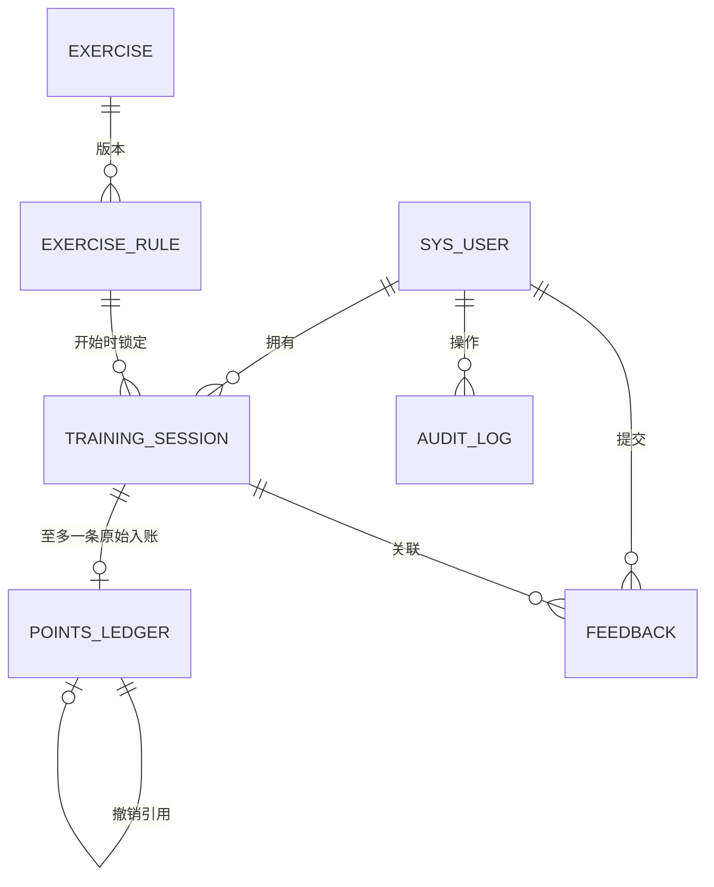

# 数据库代码框架（模型对齐版）

本目录定义**逻辑数据结构、访问契约**，并提供一个无 MySQL 的局域网本地模拟服务；不包含生产数据库实例、后端 ORM 或正式部署脚本。其他模块（账号、运动配置、会话结算、记录查询、排行榜、规则管理、本地视频库）可以直接以这里的表、约束、视图和接口契约为共同基线。

依据：

- `need/校园智能运动平台_需求分析文档.md` 第 8.1 节“业务实体与数据字典”、第 8.2 节“实体关系模型”；
- `docs/model-docs/canonical-rules.md`（动作、计数、质量分和积分的权威口径）；
- 需求 8.4 删除要求、6.2 结算/排名规则、7.5 会话状态机。

> 旧版“平板支撑 + 靠墙静蹲、有效时长换积分”的数据库结构已停用。当前基线是模型实现的五种动作：**深蹲、俯卧撑、弓步蹲、平板支撑、开合跳**。

## 文件

| 文件 | 用途 |
|---|---|
| `schema.sql` | 8 张业务表 + 2 个聚合视图，MySQL 8.0.16+ |
| `seed.sql` | 五种运动项目及各自 v1 已发布规则，供联调 |
| `API.md` | HTTP 接口契约、请求/响应、错误码、事务与权限 |
| `openapi.yaml` | 同一契约的 OpenAPI 3.0.3 描述，可供客户端/服务端生成代码 |
| `local-server/` | 无数据库的局域网本地模拟服务，元数据 JSON + 视频本地文件 |
| `README.md` | 字段约定、约束边界、关键事务与查询示例 |

## 与模型的映射

仓库根目录 `src/` 的 C++ 核心 的 C++ 核心是评分与计数的权威实现。数据库只保存模型输出的摘要，不保存逐帧关键点。

| 模型概念 | 数据库字段 | 说明 |
|---|---|---|
| `ExerciseType`（0—4） | `exercise.code` / `exercise.exercise_type` | squat/pushup/lunge/plank/jumpingjack；reps/hold |
| `PoseFeatures` | 不落库 | 只在本机计算 |
| `EvaluationResult` | 不落库 | 单帧结果只用于实时反馈 |
| `RepetitionCounter` | 规则中的 `enter_threshold/exit_threshold` | 0.75 / 0.55 |
| `WorkoutSession::summary().repetitions` | `training_session.repetitions` | 保持型为 0 |
| `summary().points` | `training_session.model_points` | 日上限前的基础分 |
| `summary().calories` | `training_session.calories` | 模型卡路里 |
| `summary().averageQuality` | `training_session.average_quality` | 0—1 |
| `summary().elapsedSeconds` | `training_session.valid_duration_ms` | 毫秒存储；展示/统计用 |
| `rep`/`hold` 积分 | `exercise_rule.points_per_rep/points_per_second` | 10 分/次；1.5 分/秒 |
| 日上限 | `exercise_rule.daily_points_cap` | 默认 600，平台级配置 |

模型公式：

- 计数型：每次完成 `points += floor(10 × 质量分)`；卡路里按动作常量累加。
- 平板支撑：`points = floor(elapsedSeconds × 0.15 × 10)`；卡路里 `elapsedSeconds × 0.15`。
- 质量分：深蹲/弓步蹲基础 1.0，膝差 >20° 或髋角 <60° 降为 0.7；俯卧撑基础 1.0，髋角 <150° 或 >200° 降为 0.7；平板支撑 `max(0, 1 - abs(hip-180)/60)`；开合跳目标内 1.0，否则 0.7。
- 可见性：必要关节 ≥ 0.50；否则该特征不可用，不更新计数。

## 实体映射

| 需求实体 | 表 | 说明 |
|---|---|---|
| User | `sys_user` | 登录标识唯一；只存密码不可逆验证值；排名意愿默认关闭 |
| Exercise | `exercise` | 项目编码稳定；`exercise_type` 区分计数/保持；是否启用由服务层结合已发布规则校验 |
| Rule | `exercise_rule` | 项目内版本唯一；`draft/published/retired`；历史版本解释旧记录 |
| Session | `training_session` | 对外 `public_id` 作为幂等键；有效运动时长不得超过自然时长；保存模型摘要 |
| Ledger | `points_ledger` | `credit` 原始入账 + `reversal` 撤销记录；一个会话至多一条原始入账 |
| Feedback | `feedback` | 会话可为空；复合外键防止引用他人会话 |
| Audit | `audit_log` | 追加写；只存对象 ID 与去标识摘要，不存密码/影像 |



## 统一约定

1. **时间**：所有 `DATETIME(3)` 按 UTC 写入，连接需设置 `time_zone = '+00:00'`；不要依赖服务器本地时区。业务日界线仍是 Asia/Shanghai 零点，由服务层换算后写入 `points_ledger.attribution_date`（中国无夏令时，可直接按 `+08:00` 换算）。
2. **时长**：统一为非负整数毫秒，不用“有效帧数 ÷ 假定帧率”。
3. **次数**：`repetitions` 为非负整数；平板支撑固定为 0。
4. **质量分**：数据库存 0—1 的小数（`DECIMAL(5,4)`）；接口展示时可乘 100。
5. **积分**：`SMALLINT UNSIGNED`；0 分也写一条 `credit`，用于区分“未结算”和“结算后无积分”。`model_points` 是日上限前的基础分，`base_points` 复制该值，`actual_points` 是日上限后的实际入账。
6. **主键**：内部使用 `BIGINT UNSIGNED`；会话额外提供 `public_id CHAR(36)`，客户端只接触 UUID。
7. **字符集**：`utf8mb4` / `utf8mb4_0900_ai_ci`，可保存中文昵称与动作说明。
8. **删除**：会话采用 `deleted_at` 软删除，统计和榜单统一加 `deleted_at IS NULL`；账号用 `status='deleted'`，不物理删除审计对象。
9. **规则版本**：发布后不可覆盖，只允许 `draft -> published -> retired`；新会话锁定当时最新已发布规则。

## 应用方式

要求 MySQL 8.0.16+（`CHECK` 约束从该版本开始真正生效）。

在 MySQL 客户端中：

```sql
CREATE DATABASE IF NOT EXISTS campus_sport
  DEFAULT CHARACTER SET utf8mb4 COLLATE utf8mb4_0900_ai_ci;
USE campus_sport;
SOURCE database/schema.sql;
SOURCE database/seed.sql;
```

PowerShell 管道方式：

```powershell
mysql --default-character-set=utf8mb4 -u root -p -e "CREATE DATABASE IF NOT EXISTS campus_sport DEFAULT CHARACTER SET utf8mb4 COLLATE utf8mb4_0900_ai_ci;"
Get-Content .\database\schema.sql -Raw | mysql --default-character-set=utf8mb4 -u root -p campus_sport
Get-Content .\database\seed.sql   -Raw | mysql --default-character-set=utf8mb4 -u root -p campus_sport
```

后端连接串至少确认：

- 会话时区为 UTC（JDBC 可用 `connectionTimeZone=UTC`，Node 的 mysql2 可用 `timezone: 'Z'`）；
- 字符集为 `utf8mb4`；
- 开启严格模式，避免超长文本、非法枚举被静默截断。

`seed.sql` 中的角度、距离、质量和积分是课程联调示例，不是体育评分标准；正式试用前应按需求 Q02 完成确认。账号不由种子创建，注册接口必须先用 bcrypt/argon2 生成哈希再写 `sys_user.password_hash`。

## 约束由谁保证

数据库已经直接保证：

- 登录标识、项目编码、项目内规则版本、会话 `public_id` 唯一；
- 一个会话至多一条 `credit`、至多一条 `reversal`（唯一键）；
- `valid_duration_ms <= natural_duration_ms`，结束时间不早于开始时间；
- 有效运动时长、次数、积分、卡路里非负；平均质量分 0—1；反馈正文 1—1000 字；
- 规则进入阈值大于退出阈值、可见性 0—1、目标方向与边界一致；
- 账本中的用户必须就是会话拥有者（复合外键）；
- 反馈不能引用他人的会话（复合外键）；
- 撤销记录必须指向一条原入账（`CHECK` + 自引用外键）。

服务层仍需保证（SQL 不适合或不应硬编码）：

- 密码哈希、登录锁定、角色与资源归属校验；
- 已发布规则不可覆盖；启用项目前必须存在完整且已发布的规则；
- 同一时刻所有启用规则使用同一个 `daily_points_cap`；如果以后允许不同项目不同日上限，应先把它抽成独立的平台配置表；
- 计数状态机、动作质量分、模型积分和卡路里由模型/端侧计算，服务端校验边界与一致性；
- 结算幂等、每日上限的原子扣减、同会话并发幂等；
- 归属日/周换算、删除后的积分撤销与榜单重算；
- 排行榜只输出昵称、积分、名次，不输出 `user_id`、学号或姓名。

没有使用触发器和存储过程，是为了让规则集中在服务层、便于单元测试和后续迁移。

## 接口契约

`database/API.md` 和 `database/openapi.yaml` 定义服务端 HTTP 接口。摘要：

| 方法 | 路径 | 用途 | 主要表 |
|---|---|---|---|
| POST | `/api/v1/auth/register` | 注册 | `sys_user` |
| POST | `/api/v1/auth/login` | 登录，返回 Bearer Token | `sys_user` |
| POST | `/api/v1/auth/logout` | 退出 | — |
| GET | `/api/v1/me` | 当前用户 | `sys_user` |
| PATCH | `/api/v1/me` | 昵称/排名意愿 | `sys_user` |
| GET | `/api/v1/exercises` | 已启用动作及当前规则 | `exercise`、`exercise_rule` |
| GET | `/api/v1/exercises/{code}` | 动作详情 | `exercise`、`exercise_rule` |
| POST | `/api/v1/sessions` | 开始会话，锁定规则版本 | `training_session` |
| PATCH | `/api/v1/sessions/{publicId}/state` | 同步状态/心跳/断网恢复 | `training_session` |
| POST | `/api/v1/sessions/{publicId}/finish` | 提交模型摘要并结算 | `training_session`、`points_ledger` |
| POST | `/api/v1/sessions/{publicId}/abort` | 主动放弃，不计分 | `training_session` |
| GET | `/api/v1/sessions` | 个人记录分页/筛选 | `training_session`、`points_ledger` |
| GET | `/api/v1/sessions/{publicId}` | 记录详情 | `training_session`、`points_ledger` |
| DELETE | `/api/v1/sessions/{publicId}` | 软删除并撤销积分 | `training_session`、`points_ledger` |
| GET | `/api/v1/stats/weekly` | 个人周趋势 | `training_session`、`points_ledger` |
| GET | `/api/v1/leaderboard/weekly` | 周榜 | `v_weekly_leaderboard` |
| GET | `/api/v1/leaderboard/me` | 我的名次 | `v_weekly_leaderboard` |
| POST | `/api/v1/feedback` | 提交反馈 | `feedback` |
| GET | `/api/v1/feedback/me` | 我的反馈 | `feedback` |
| POST | `/api/v1/admin/exercises/{code}/rules` | 创建规则草稿 | `exercise_rule` |
| POST | `/api/v1/admin/rules/{ruleId}/publish` | 发布规则版本 | `exercise_rule`、`audit_log` |
| POST | `/api/v1/admin/exercises/{code}/disable` | 停用项目 | `exercise`、`audit_log` |
| GET | `/api/v1/admin/feedback` | 反馈列表 | `feedback` |
| PATCH | `/api/v1/admin/feedback/{id}` | 处理反馈 | `feedback`、`audit_log` |
| GET | `/api/v1/admin/audit` | 审计查询 | `audit_log` |
| POST | `/api/v1/videos` | 本地上传视频（局域网模拟） | `local_video_asset` + 本地文件 |
| GET | `/api/v1/videos` | 本机视频库列表 | `local_video_asset` |
| GET | `/api/v1/videos/{videoId}` | 视频元数据 | `local_video_asset` |
| GET | `/api/v1/videos/{videoId}/content` | 视频内容/Range 回放 | 本地文件 |
| DELETE | `/api/v1/videos/{videoId}` | 删除本地视频 | `local_video_asset` + 本地文件 |

详细字段、状态码和示例见 `API.md`；机器可读定义见 `openapi.yaml`。

## 本地视频库（局域网模拟）

在 MySQL 尚未落地时，`local-server/` 提供一个零依赖的本地 API：

```bash
node database/local-server/server.mjs
```

- 默认监听 `0.0.0.0:8787`，手机与电脑在同一 Wi-Fi 时打开 `http://<电脑IP>:8787/`。
- 同时托管 `ui/` 静态页面和 `/api/v1/videos` 视频端点，UI 上传、回放、删除都走同源接口。
- 数据保存在 `database/local-server/data/`：
  - `store.json`：视频元数据；
  - `videos/`：原始视频文件，不进入 MySQL。
- 默认上传上限 200 MB，可用 `MAX_UPLOAD_BYTES` 调整；端口可用 `PORT` 调整。
- 这是“本地优先、类似微信”的模拟：清理 `data/` 目录即删除本机视频和元数据，不能从中心库恢复。
- 本地模式用 `owner` 区分档案，不构成身份认证；正式部署需换成 Bearer Token 与资源归属校验。
- `local-server` 当前实现 `GET /health` 与第 8 节视频端点；账号、会话、排行榜等其余接口仍按 `API.md` 契约，待接入 MySQL/正式后端时实现。

## 关键事务示例

### 1. 结算：幂等 + 日上限

```sql
-- 避免 REPEATABLE READ 旧快照漏算上一笔已提交入账
SET TRANSACTION ISOLATION LEVEL READ COMMITTED;
START TRANSACTION;

-- 1）锁定会话，并校验归属与规则
SELECT s.session_id, s.user_id, s.status, s.valid_duration_ms, s.natural_duration_ms,
       s.repetitions, s.average_quality, s.calories, s.model_points,
       r.daily_points_cap
FROM training_session s
JOIN exercise_rule r ON r.rule_id = s.rule_id
WHERE s.public_id = ? AND s.user_id = ? AND s.deleted_at IS NULL
FOR UPDATE;

-- 2）已存在原始入账：直接返回原结果，不重复加分
SELECT entry_id, base_points, actual_points, attribution_date
FROM points_ledger
WHERE session_id = ? AND entry_type = 'credit';

-- 3）锁定用户行，串行化同一用户的并发结算
SELECT user_id FROM sys_user WHERE user_id = ? FOR UPDATE;

-- 4）当日已入账积分（跨项目共同计算）
SELECT COALESCE((
    SELECT credited_points
    FROM v_user_daily_points
    WHERE user_id = ? AND attribution_date = ?
), 0) AS used;

-- 5）基础分 = 模型 model_points；实际入账受日上限扣减
--    base   = s.model_points
--    actual = LEAST(base, GREATEST(daily_points_cap - used, 0))
INSERT INTO points_ledger
    (session_id, user_id, entry_type, base_points, actual_points, attribution_date)
VALUES (?, ?, 'credit', ?, ?, ?);

UPDATE training_session
SET status = 'settled', submitted_at = COALESCE(submitted_at, UTC_TIMESTAMP(3)),
    settled_at = UTC_TIMESTAMP(3)
WHERE session_id = ?;

COMMIT;
```

要点：

- `public_id` 的唯一性和 `uk_ledger_session_type` 共同兜底“同一会话只结算一次”；并发重试时捕获唯一键冲突并返回原结果。
- 用户行锁让同一用户的结算串行执行，避免两个会话同时读到 590 分都各加 20 分；日上限汇总必须在 `READ COMMITTED` 下读取，或改为锁定读。
- 归属日期取**服务端确认结算时**的 Asia/Shanghai 日期；跨日会话整体归结束日，不拆分。
- 校验失败会将会话置为 `abnormal_end`，不写账本。
- 模型积分由端侧/模型适配器产生，服务端校验 `model_points` 与 `repetitions/average_quality/calories` 的边界；正式防作弊需另立需求。

### 2. 删除记录并撤销积分

```sql
START TRANSACTION;

SELECT session_id, user_id FROM training_session
WHERE session_id = ? AND user_id = ? AND deleted_at IS NULL
FOR UPDATE;

-- 与结算共用用户行锁，避免删除与结算交叉
SELECT user_id FROM sys_user WHERE user_id = ? FOR UPDATE;

-- 原入账失效
UPDATE points_ledger
SET status = 'revoked'
WHERE session_id = ? AND entry_type = 'credit' AND status = 'active';

-- 写一条撤销记录（金额复制原入账，仅作审计；日上限和周榜不再汇总它）
INSERT INTO points_ledger
    (session_id, user_id, entry_type, base_points, actual_points,
     attribution_date, status, reverses_entry_id)
SELECT session_id, user_id, 'reversal', base_points, actual_points,
       attribution_date, 'active', entry_id
FROM points_ledger
WHERE session_id = ? AND entry_type = 'credit';

UPDATE training_session SET deleted_at = UTC_TIMESTAMP(3) WHERE session_id = ?;

COMMIT;
```

重复删除时 `deleted_at IS NULL` 条件和唯一键会阻止二次撤销；其他会话不补发此前因日上限被扣减的积分。

### 3. 个人记录查询

```sql
SELECT s.public_id, e.code, e.name AS exercise_name, e.exercise_type,
       s.started_at, s.ended_at, s.natural_duration_ms, s.valid_duration_ms,
       s.repetitions, s.average_quality, s.calories, s.model_points,
       s.status, s.deleted_at, r.version_no AS rule_version,
       l.base_points, l.actual_points, l.attribution_date
FROM training_session s
JOIN exercise e ON e.exercise_id = s.exercise_id
JOIN exercise_rule r ON r.rule_id = s.rule_id
LEFT JOIN points_ledger l
       ON l.session_id = s.session_id AND l.entry_type = 'credit'
WHERE s.user_id = ?
  AND s.deleted_at IS NULL
  AND (? IS NULL OR s.exercise_id = ?)
  AND (? IS NULL OR s.started_at >= ?)
  AND (? IS NULL OR s.started_at <  ?)
ORDER BY s.started_at DESC
LIMIT 20 OFFSET ?;
```

### 4. 周榜

```sql
SELECT nickname, total_points, rank_no
FROM v_weekly_leaderboard
WHERE week_start = ?
ORDER BY rank_no, user_id
LIMIT 20 OFFSET ?;
```

视图已过滤 `status='settled'`、未删除、账本有效且 `ranking_opt_in = 1` 的用户；`RANK()` 产生 1、1、3 的同分名次，`user_id` 只用于稳定展示顺序和定位“我的名次”，不得返回给前端。

### 5. 当日积分与周汇总

```sql
-- 当日已入账
SELECT credited_points
FROM v_user_daily_points
WHERE user_id = ? AND attribution_date = ?;

-- 周趋势：按项目汇总每日有效运动时长、次数、质量与积分（无记录日期由服务层补 0）
SELECT s.exercise_id, e.code, DATE(l.attribution_date) AS day,
       SUM(s.valid_duration_ms) AS valid_ms,
       SUM(s.repetitions)       AS reps,
       AVG(s.average_quality)   AS avg_quality,
       SUM(s.calories)          AS calories,
       SUM(l.actual_points)     AS points
FROM training_session s
JOIN exercise e ON e.exercise_id = s.exercise_id
JOIN points_ledger l
  ON l.session_id = s.session_id AND l.entry_type = 'credit' AND l.status = 'active'
WHERE s.user_id = ?
  AND s.deleted_at IS NULL
  AND l.attribution_date BETWEEN ? AND ?
GROUP BY s.exercise_id, e.code, l.attribution_date
ORDER BY l.attribution_date;
```

## 会话状态

`schema.sql` 中 `training_session.status` 与需求 7.5 对应：

| 状态 | 含义 |
|---|---|
| `preparing` | 准备中，尚未开始计数/保持 |
| `detecting` | 检测中，尚未进入动作判定 |
| `timing` | 运动中，累计有效运动时长；计数型可随时完成一次 |
| `auto_paused` | 不达标/不可判断/页面隐藏导致的异常暂停 |
| `user_paused` | 用户主动暂停，必须主动恢复 |
| `pending_submit` | 已结束或断网，摘要冻结，等待提交 |
| `settled` | 服务端校验通过并完成结算，不可再累计 |
| `abnormal_end` | 校验失败或无效结束，不写账本 |

状态迁移由服务层控制；数据库只保存结果，避免把业务状态机写死在触发器中。

## 隐私与保留

- 原始视频与逐帧关键点不进入任何表；`anomaly_summary` 只存原因码与毫秒数。
- 排行榜视图只暴露昵称、积分、名次；接口层不得把 `user_id` 返回前端，也不得查询学号或姓名。
- 审计只记录操作者 ID、对象 ID、动作、时间、结果，不记录密码、令牌、影像或被删除的运动详情。
- 账号注销时：关闭排名、终止进行中会话、软删除个人会话、撤销有效入账；审计事件保留去标识部分。
- 保留期到期后的物理清理顺序：先删 `reversal`，再删 `credit`，将 `feedback.session_id` 置空，最后删会话（账本自引用外键为 `RESTRICT`）；审计只保留 `audit_log` 中的去标识事件。

## 后续模块接入顺序

1. **模型适配器**：端侧运行 MediaPipe + 仓库根目录 `src/` 的 C++ 核心 规则（或编译 `cadence_wasm`），输出 `repetitions / points / calories / averageQuality / elapsedSeconds`；接口字段见 `API.md` 的 `ModelSummary`。
2. **账号模块**：写 `sys_user`，登录查询 `login_id` + `password_hash`，排名开关更新 `ranking_opt_in`。
3. **运动配置模块**：读 `exercise` 与最新 `published` 规则；选规则时按 `status='published' AND (effective_from IS NULL OR effective_from <= UTC_TIMESTAMP(3))` 取 `version_no` 最大者，并在会话开始时写入 `rule_id`；发布新版本时插入新行，不覆盖旧行。
4. **实时运动模块**：开始时插入 `training_session`（服务端生成 `public_id`，锁定 `rule_id`），按状态机更新状态与有效运动时长；结束时提交模型摘要。
5. **结算模块**：按上面的结算事务写 `points_ledger` 并置 `settled`。
6. **记录/统计模块**：查询 `training_session`、`points_ledger` 与两个视图。
7. **管理模块**：规则发布、失效标记、反馈处理写 `feedback` 和 `audit_log`。

后续如果引入 Flyway/Liquibase，把 `schema.sql` 作为基线，新增变更不要直接改这个文件，另建 `V2__xxx.sql` 之类的迁移。当前 `schema.sql` 已是模型对齐后的新基线；已有旧库请按字段差异编写迁移，至少包括：`exercise.exercise_type`、`exercise_rule.main_metric/target_*/points_*/calories_*/enter_threshold/exit_threshold`、`training_session.repetitions/average_quality/calories/model_points`，以及删除旧字段 `min_match_score/stable_hold_ms/max_sample_gap_ms/points_multiplier`。
